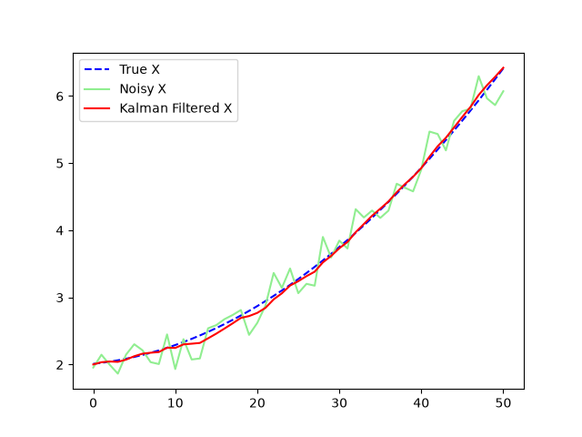
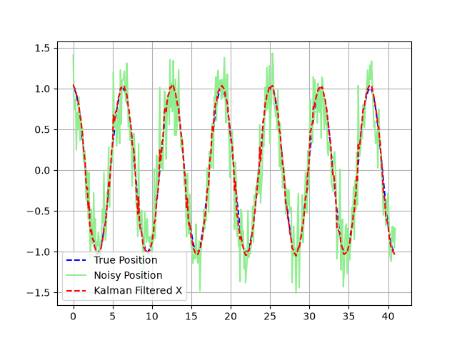

# Kalman Filter from Scratch

## Overview

The Kalman Filter is a mathematical algorithm that is used to work with uncertainties in measurements and predictions. This algorithm combines probability and linear algebra. It is widely used in various fields such as robotics, computer vision, and control systems.

This repository contains the implementation of a Kalman Filter from scratch using NumPy and SymPy. The project includes two main classes:
- `simpleKalman`: for linear systems.
- `extendedKalman`: for non-linear systems using Jacobian linearization.

## Simple Kalman Filter

### Equations

The standard Kalman filter operates in two steps:

**1. Prediction**

$$
\bar{\mu}_t = A \mu_{t-1} + B u_t
$$

$$
\bar{\Sigma}_t = A \Sigma_{t-1} A^T + R
$$

Where:
- $\mu$: state estimate
- $\Sigma$: state covariance
- $A$: state transition matrix
- $B$: control input matrix
- $u$: control vector
- $R$: process noise covariance

**2. Update**

$$
K_t = \bar{\Sigma}_t C^T (C \bar{\Sigma}_t C^T + Q)^{-1}
$$

$$
\mu_t = \bar{\mu}_t + K_t (z_t - C \bar{\mu}_t)
$$

$$
\Sigma_t = (I - K_t C) \bar{\Sigma}_t
$$

Where:
- $K$: Kalman gain
- $z$: measurement vector
- $C$: measurement matrix
- $Q$: measurement noise covariance

### MRUA Kinematic Model

The linear example in `testSimple.py` models movement with uniform acceleration. The state vector contains position and velocity:

$$
x = \begin{bmatrix} p_x \\ p_y \\ p_z \\ v_x \\ v_y \\ v_z \end{bmatrix}
$$

Using time step $\Delta t$, the state transition matrix $A$ and control matrix $B$ are defined from the kinematic equations $p_t = p_0 + v_0 \Delta t + \frac{1}{2} a \Delta t^2$ and $v_t = v_0 + a \Delta t$:

$$
A = \begin{bmatrix}
1 & 0 & 0 & \Delta t & 0 & 0 \\
0 & 1 & 0 & 0 & \Delta t & 0 \\
0 & 0 & 1 & 0 & 0 & \Delta t \\
0 & 0 & 0 & 1 & 0 & 0 \\
0 & 0 & 0 & 0 & 1 & 0 \\
0 & 0 & 0 & 0 & 0 & 1
\end{bmatrix}
$$

$$
B = \begin{bmatrix}
\frac{1}{2}\Delta t^2 & 0 & 0 \\
0 & \frac{1}{2}\Delta t^2 & 0 \\
0 & 0 & \frac{1}{2}\Delta t^2 \\
\Delta t & 0 & 0 \\
0 & \Delta t & 0 \\
0 & 0 & \Delta t
\end{bmatrix}
$$

### Example and usage

The script is designed to be modular, you can easily use the classes in other projects, but running the script will run the main function which contains a simple example of the kalman filter in action in a MRUA scenario. With Gaussian noise added to the measurements, the Kalman filter is able to estimate the true position of the object, even when the measurements are extremely noisy. Matplotlib is used to visualize the results only in the main function, but it is not a requirement to use the classes.

## Extended Kalman Filter

### Non-linear Systems and the Jacobian

When system transitions or measurements are non-linear, the standard Kalman filter cannot propagate Gaussian distributions directly. The Extended Kalman Filter linearizes non-linear functions around the current estimate using a first-order Taylor expansion:

$$
\bar{\Sigma}_t = G_t \Sigma_{t-1} G_t^T + R
$$

Where $G_t$ is the Jacobian matrix of partial derivatives evaluated at the current state:

$$
G_t = \frac{\partial f}{\partial x}
$$

The implementation in `testExtended.py` tests a non-linear trigonometric system defined by:

$$
f(x, y) = \begin{bmatrix} \cos(x) \\ \sin(y) \end{bmatrix}
$$

Its symbolic Jacobian matrix is computed as:

$$
G = \begin{bmatrix}
\frac{\partial \cos(x)}{\partial x} & \frac{\partial \cos(x)}{\partial y} \\
\frac{\partial \sin(y)}{\partial x} & \frac{\partial \sin(y)}{\partial y}
\end{bmatrix} = \begin{bmatrix}
-\sin(x) & 0 \\
0 & \cos(y)
\end{bmatrix}
$$

The extended kalman filter in this case uses the sympy library to calculate the jacobian from the symbolic representation of the functions. I used my own implementation of the jacobian matrix calculation using sympy library, but you can also use `sympy.jacobian()` to calculate the jacobian matrix. My function returns the evaluated jacobian matrix with respect to the current state vector. Also will show the symbolic jacobian matrix.

## Reference

The equations of this algorithm are widely known, but my implementation is based on the book *Probabilistic Robotics* by Sebastian Thrun, Wolfram Burgard, and Dieter Fox.
